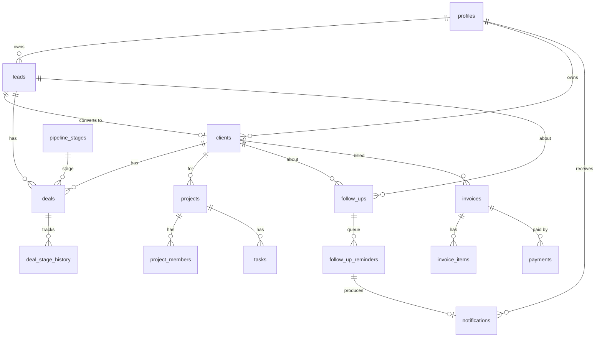

# Architecture

```
Browser (React + Vite + TS)  ──anon key + user JWT──▶  Supabase
   │  RPC / PostgREST                                     ├─ Auth (hashed passwords)
   │  Realtime (convenience only)                         ├─ Postgres: tables + RLS + triggers + RPCs
   └─ functions.invoke('admin-users') ─▶ Edge Function ───┤     └─ pg_cron → app.process_due_reminders() every minute
                                         (service role,   └─ (service-role key exists ONLY inside the Edge Function / your shell)
                                          Super Admin only)
```

## Schema (migrations in `supabase/migrations`)

Also: `role_permissions`, `organization_settings`, `user_preferences`, `activities`, `audit_events`, `scheduler_runs`.

## Follow-up reminder engine
1. `create_follow_up(date, time, timezone, …)` converts local time → UTC **on the server**; rejects past times.
2. Insert trigger writes one `follow_up_reminders` row per chosen offset + one *overdue* row (default 30 min after due).
3. `pg_cron` runs `app.process_due_reminders()` each minute **inside Postgres** (no browser, no Edge Function in the path).
4. The processor claims due rows `FOR UPDATE SKIP LOCKED`, re-validates against the live follow-up (status, `schedule_version`, `due_at`), inserts the notification with unique `dedupe_key = 'fur:<reminder id>'`, marks the row fired: one transaction, so a crash retries cleanly.
5. Reschedule bumps `schedule_version` → every older pending row is cancelled. Complete/cancel cancels all pending rows. Rows are never deleted (history).
6. Downtime: rows with `fire_at <= now()` stay pending and all deliver when the scheduler resumes; `scheduler_runs.max_lag_seconds` records the catch-up. The dashboard warns Super Admins if no run in 5 minutes.
7. "Overdue" is derived (`pending AND due_at < now()`), never stored, so every device agrees.

Channels: **in-app only.** No email/push/SMS/WhatsApp provider is configured, so none is claimed.

## Permission matrix (source of truth: `role_permissions`; scoping rules are in RLS)
| Capability | SA | CSO | Sales | PM | TL | Dev | Fin |
|---|:-:|:-:|:-:|:-:|:-:|:-:|:-:|
| Manage users / settings / audit | ● | | | | | | |
| Leads: all / own | all | all | own | – | – | – | – |
| Deals | all | all | own | – | – | – | – |
| Clients | all | all | own | read | via project | via project | read |
| Follow-ups: create | ● | ● | ● | ● | | | |
| Follow-ups: see all | ● | ● | own | own | own | own | own |
| Projects | all | read | – | manage | own | member | read |
| Tasks | all | – | – | all / create | own project / delegate to devs | own, status only | – |
| Invoices & payments | ● | | | | | | ● |
| Reports | all | sales | | projects | | | finance |

## Security controls
Deny-by-default grants (0005) · column-level UPDATE grants (no self-promotion; `created_by` not browser-writable) · RLS on every table · definer functions with pinned `search_path` · notifications/audit/activities writable only by server code · invoice immutability + overpayment guard · Edge Function verifies JWT, requires active Super Admin, rate-limits, audits, never returns stored secrets.
